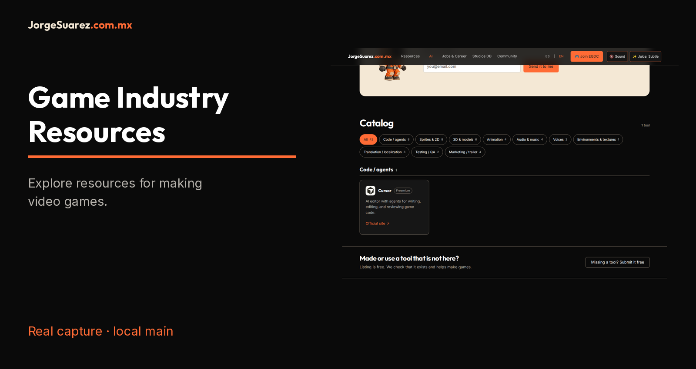
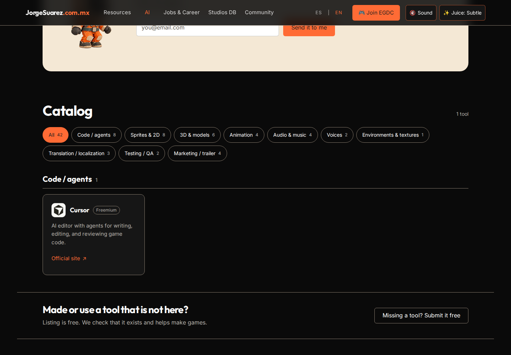
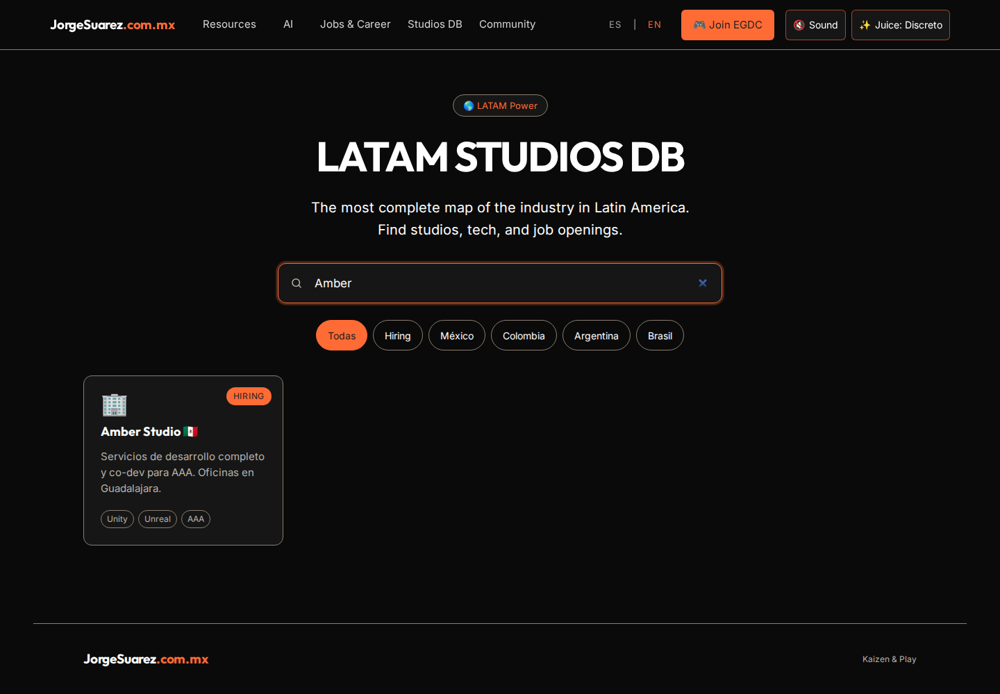

[Español](README.md) | [English](README.en.md)

# Game Industry Resources

## What is it and why does it exist?
A resource website for people making video games, focused on Latin America. It brings directories and guides together for discovery; it is not a recruitment platform or a vendor certification service.

## Who is it for?
Students, independent developers and teams looking for tools, studios or career guidance. Use a modern browser; browsing requires no account or programming knowledge. Hosting your own copy requires technical help.

## How do I start?
1. Open the [AI directory](https://gamedev.jorgesuarez.com.mx/ia/). Screenshots come from locally served `main`, not a certification of the public deployment.
2. Enter **Cursor** in Search tools: the verified copy filtered from 42 tools to one match. Browse categories and check each tool's terms and prices on its official website.
3. In [Studios DB](https://gamedev.jorgesuarez.com.mx/database.html), search **Amber**: local search leaves the matching card. Hiring labels do not prove current openings.
4. In [Jobs & Career](https://gamedev.jorgesuarez.com.mx/jobs.html), explore links and the CV guide. Confirm every opening with the studio. Do not submit email, sponsorship requests or payments to follow this walkthrough.

On a phone: [readable portrait screenshot](docs/media/mobile-search-en.png). Open screenshots at full size to read every control.

## When should I use it or avoid it?
Use it to discover resources and links. Not to verify live vacancies, obtain legal advice or assume a tool meets your game's licensing, privacy or production needs.

## Where and what is available?
[Home](https://gamedev.jorgesuarez.com.mx) · [Source](https://github.com/jorgefsb/game-industry-resources). Local `main` verified on October 22, 2026: home, Jobs, Studios DB, Tools and AI directory load. AI and studio searches verified in ES/EN. Other branches and pending PRs were not verified.

## Cost and licensing
Browsing the copy showed no charge. The directory advertises free browsing and USD 49/month featured placement; payment, activation, cancellation and submission were not tested. External tools set their own prices. This snapshot has no LICENSE: do not assume MIT or general redistribution permission. Branding and third-party logos have separate restrictions.

## Privacy
Language preference is saved in `localStorage`. Newsletter, tool submission and featured placement forms attempt to send data to `/ia/api/`; a local static server does not implement them. Worker code exists, but its deployment, storage and retention policies were not verified. We submitted no forms or payments. External links have their own policies.

## Limits and help
- Jobs shows a list/ticker based on repository data, not a verified live vacancy feed.
- Studios DB uses local data: confirm country, technology and hiring with each studio.
- Tools displays Standard GDD, Project Budget and Release Checklist, but all three buttons link to `#`: **no verified working download**.
- Portfolio and Interview Prep are marked coming soon. A page or button does not prove an operational service.
- For errors or stale links, [open an issue](https://github.com/jorgefsb/game-industry-resources/issues) without sensitive data. No guaranteed support response time.

## Video and next steps

[MP4 · EN](docs/media/walkthrough-en.mp4) · [VTT](docs/media/walkthrough-en.vtt) · [Texto / Transcript](docs/media/transcript-en.md)

[Technical guide](docs/TECHNICAL.en.md) · [Documentation canon](docs/REPOSITORY-DOCUMENTATION.en.md) · [Media notice](docs/ASSET-NOTICE.md)

Built by [Jorge Suárez](https://jorgesuarez.com.mx) · [Brandkit oficial / Official brandkit](https://brandkit.jorgesuarez.com.mx/)
