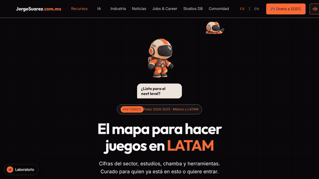
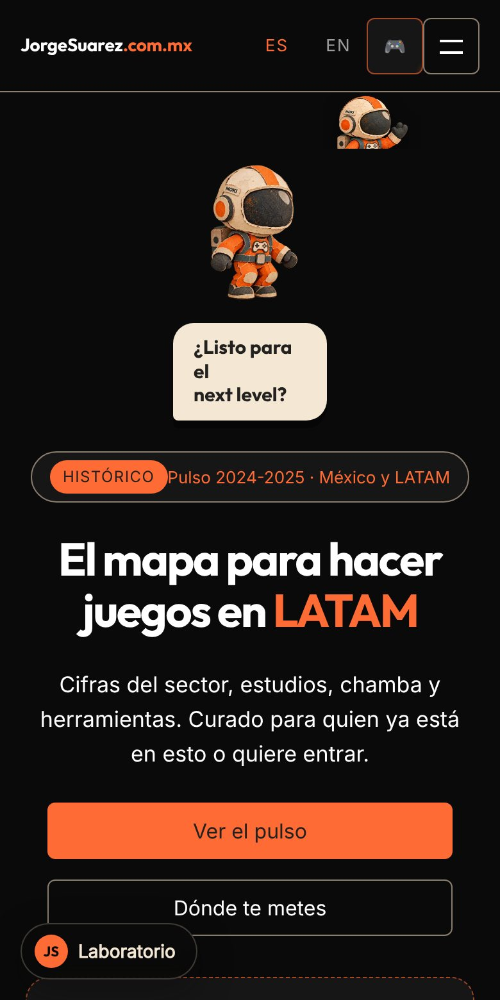

<div align="center">

<a href="https://gamedev.jorgesuarez.com.mx"></a>

<br />

<a href="./README.md"></a>


<br />

**[▶ Abrir el sitio](https://gamedev.jorgesuarez.com.mx)** · Más proyectos en [github.com/jorgefsb](https://github.com/jorgefsb)

</div>

---

<p align="center"></p>
<p align="center"><sub>Recorrido real del sitio en vivo, grabado el 10 nov 2026 en Chromium (1280×720). Sin retoque. <a href="docs/readme/tour.mp4">Ver el video MP4</a></sub></p>

## ¿Qué es?

Un sitio gratis con el mapa para hacer videojuegos en Latinoamérica: cifras del sector, estudios de la región, trabajo y carrera, herramientas de producción, marketing y un directorio de herramientas de IA. Está en español, con versión en inglés.

## ¿Para quién es?

Para quien ya hace videojuegos en la región o quiere entrar: estudiantes, devs indie, gente que busca su primera chamba en la industria y quienes están fundando un estudio.

## ¿Qué dolor resuelve?

La información para vivir de hacer videojuegos en LATAM está regada. Saber qué estudios existen, dónde hay trabajo, cómo armar un CV para la industria o qué herramienta de IA le sirve a tu juego obliga a juntar piezas de muchos lados.

## La propuesta

Juntarlo en un solo mapa, curado desde más de dos décadas de hacer videojuegos, estudios y comunidad en México, y dejarlo abierto. Cada sección contesta una pregunta:

| Sección | Qué contesta |
|---|---|
| [Production Tools](https://gamedev.jorgesuarez.com.mx/tools) | ¿Con qué herramientas se produce un juego? |
| [Jobs & Career](https://gamedev.jorgesuarez.com.mx/jobs) | ¿Dónde hay trabajo y cómo me preparo? |
| [El CV Perfecto](https://gamedev.jorgesuarez.com.mx/guides/cv) | ¿Cómo armo un currículum para la industria? |
| [Studios DB](https://gamedev.jorgesuarez.com.mx/database) | ¿Qué estudios hay en Latinoamérica? |
| [Marketing Playbook](https://gamedev.jorgesuarez.com.mx/marketing) | ¿Cómo vendo mi juego y gano visibilidad? |
| [Pulso de la industria MX](https://gamedev.jorgesuarez.com.mx/industria) | ¿Cómo se ve el sector? Corte 2024-2025. |
| [Ecosistema MX](https://gamedev.jorgesuarez.com.mx/ecosistema) | ¿Qué estudios, comunidades, eventos y escuelas hay en México? |
| [Ciclo de producción](https://gamedev.jorgesuarez.com.mx/ciclo) | ¿Dónde encaja un gamedev de LATAM en pre, producción y post? |
| [Directorio de IA](https://gamedev.jorgesuarez.com.mx/ia/) | ¿Qué herramientas de IA sirven para arte, código, audio, 3D, QA y marketing? |

## ¿Cómo se usa?

1. Entra a [gamedev.jorgesuarez.com.mx](https://gamedev.jorgesuarez.com.mx).
2. Elige la sección que contesta tu pregunta.
3. No pide registro ni instalación.

## ¿Cuándo conviene y cuándo no?

Conviene cuando quieres orientarte, encontrar estudios, prepararte para una vacante o elegir herramientas.

No es un censo ni el pulso en vivo del sector: las cifras son un corte histórico 2024-2025 y el sitio lo marca así. Tampoco es una bolsa de trabajo oficial.

## ¿Dónde lo pruebo?

En vivo: **[gamedev.jorgesuarez.com.mx](https://gamedev.jorgesuarez.com.mx)**

<p align="center">
  
  
</p>
<p align="center"><sub>Capturas reales del sitio en vivo, 10 nov 2026: escritorio (1280×720) y móvil (390×780).</sub></p>

## Hasta dónde llegamos

En línea y en crecimiento. Hoy tiene nueve secciones y el directorio de IA.

Este repo también guarda `juice`, el paquete de interacción que usan los sitios de la marca (menú «Juega», sonido y Moki escondido), en sus versiones 1.0.0 a 1.2.0.

Lo que falta es seguir llenando el mapa. Si conoces un recurso que debería estar, abre un issue o manda un pull request.

## Para quien construye

Sitio estático, sin paso de build.

```bash
git clone https://github.com/jorgefsb/game-industry-resources.git
cd game-industry-resources
python3 -m http.server 3000
```

En producción se sirve como assets estáticos de un Worker de Cloudflare; `.assetsignore` lista lo que no se sube. Más contexto en [WALKTHROUGH.md](./WALKTHROUGH.md) y [BRAND-GUIDELINES.md](./BRAND-GUIDELINES.md).

## Licencia

Este repo no tiene archivo de licencia, así que el contenido conserva todos los derechos. Si quieres reutilizar algo, escríbenos a [jorgefsb@gmail.com](mailto:jorgefsb@gmail.com).

---

<div align="center">

<sub>Hecho con amor ❤️🎮 por <a href="https://jorgesuarez.com.mx">JorgeSuarez.com.mx</a> · <a href="https://github.com/jorgefsb">Más proyectos</a> · <a href="./README.md">Read in English</a><br />Documentación actualizada el 10 nov 2026.</sub>

</div>
