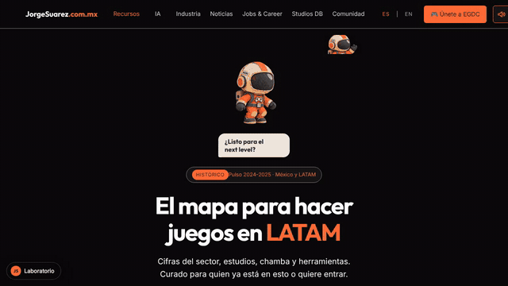
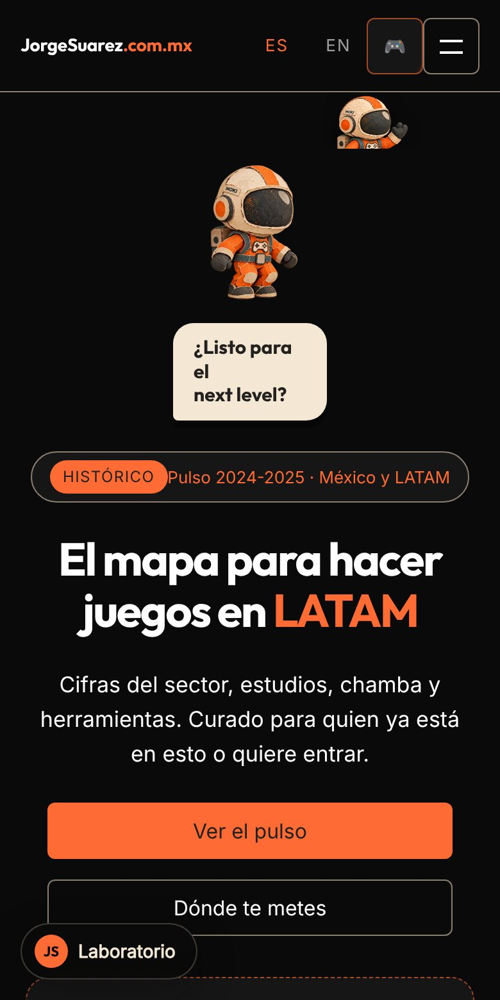

<div align="center">

<a href="https://gamedev.jorgesuarez.com.mx/?lang=en"></a>

<br />


<a href="./README.es.md"></a>

<br />

**[▶ Open the site](https://gamedev.jorgesuarez.com.mx/?lang=en)** · More projects at [github.com/jorgefsb](https://github.com/jorgefsb)

</div>

---

<p align="center"></p>
<p align="center"><sub>Real walkthrough of the live site, recorded 10 Nov 2026 in Chromium (1280×720). No retouching. It plays once; reload the page to watch it again. <a href="docs/readme/tour.mp4">Watch the MP4 video</a></sub></p>

## What is it?

A free site with the map for making video games in Latin America: industry numbers, studios in the region, jobs and careers, production tools, marketing and a directory of AI tools. It is written in Spanish and has an English version; the links on this page open it in English.

## Who is it for?

For people who already make games in the region or want to get in: students, indie devs, people looking for their first job in the industry and founders starting a studio.

## What pain does it solve?

The information you need to make a living making games in LATAM is scattered. Finding out which studios exist, where the jobs are, how to write a CV for the industry or which AI tool fits your game means collecting pieces from many places.

## The proposal

Put it on one map, curated from more than two decades of building games, studios and community in Mexico, and keep it open. Each section answers one question:

| Section | The question it answers |
|---|---|
| [Production Tools](https://gamedev.jorgesuarez.com.mx/tools?lang=en) | What does it take to produce a game? Today it has the production cycle in short and links to tools; the three downloadable templates are still in progress. |
| [Jobs & Career](https://gamedev.jorgesuarez.com.mx/jobs?lang=en) | Where are the jobs and how do I prepare? |
| [The Perfect CV](https://gamedev.jorgesuarez.com.mx/guides/cv?lang=en) | How do I write a CV for the industry? |
| [Studios DB](https://gamedev.jorgesuarez.com.mx/database?lang=en) | Which studios exist in Latin America? |
| [Marketing Playbook](https://gamedev.jorgesuarez.com.mx/marketing?lang=en) | How do I sell my game and get visibility? **In progress:** today it shows the outline; the guides cannot be opened yet. |
| [Mexico industry pulse](https://gamedev.jorgesuarez.com.mx/industria?lang=en) | What does the sector look like? 2024-2025 snapshot. |
| [Mexico ecosystem](https://gamedev.jorgesuarez.com.mx/ecosistema?lang=en) | Which studios, communities, events and schools exist in Mexico? |
| [Production cycle](https://gamedev.jorgesuarez.com.mx/ciclo?lang=en) | Where does a LATAM gamedev fit in pre-production, production and post? |
| [AI directory](https://gamedev.jorgesuarez.com.mx/ia/?lang=en) | Which AI tools help with art, code, audio, 3D, QA and marketing? |

## How do I use it?

1. Go to [gamedev.jorgesuarez.com.mx](https://gamedev.jorgesuarez.com.mx/?lang=en).
2. Pick the section that answers your question.
3. No sign-up and nothing to install.

## When it fits and when it doesn't

It fits when you want to get oriented, find studios, prepare for a job opening or choose tools.

It is not a census or a live pulse of the sector: the numbers are a historical 2024-2025 snapshot and the site labels them that way. It is not an official job board either.

## Where can I try it?

Live: **[gamedev.jorgesuarez.com.mx](https://gamedev.jorgesuarez.com.mx/?lang=en)**

<p align="center">
  
  
</p>
<p align="center"><sub>Real screenshots of the live site, 10 Nov 2026: desktop (1280×720) and mobile (390×780).</sub></p>

## How far we got

Live and growing. Today it has eight sections plus the AI directory.

Two parts are still in progress and the site does not deliver them yet: the Marketing Playbook guides and the three downloadable templates in Production Tools (GDD, budget and release checklist). Their buttons do not lead anywhere yet.

This repo also holds `juice`, the interaction package used by the brand's sites (the «Juega» menu, sound and hidden Moki), in versions 1.0.0 to 1.2.0.

What is missing is more of the map. If you know a resource that belongs here, open an issue or send a pull request.

## For builders

Static site, no build step.

```bash
git clone https://github.com/jorgefsb/game-industry-resources.git
cd game-industry-resources
python3 -m http.server 3000
```

In production it is served as the static assets of a Cloudflare Worker; `.assetsignore` lists what is not uploaded. More context in [WALKTHROUGH.md](./WALKTHROUGH.md) and [BRAND-GUIDELINES.md](./BRAND-GUIDELINES.md) (both in Spanish).

## License

This repo has no license file, so all rights are reserved on the content. If you want to reuse something, write to [jorgefsb@gmail.com](mailto:jorgefsb@gmail.com).

---

<div align="center">

<sub>Made with love ❤️🎮 by <a href="https://jorgesuarez.com.mx">JorgeSuarez.com.mx</a> · <a href="https://github.com/jorgefsb">More projects</a> · <a href="./README.es.md">Leer en español</a><br />Documentation updated on 10 Nov 2026.</sub>

</div>
