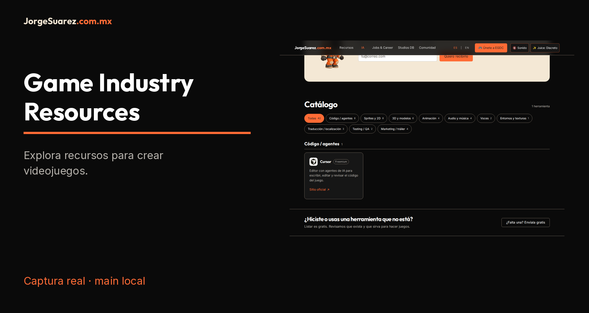
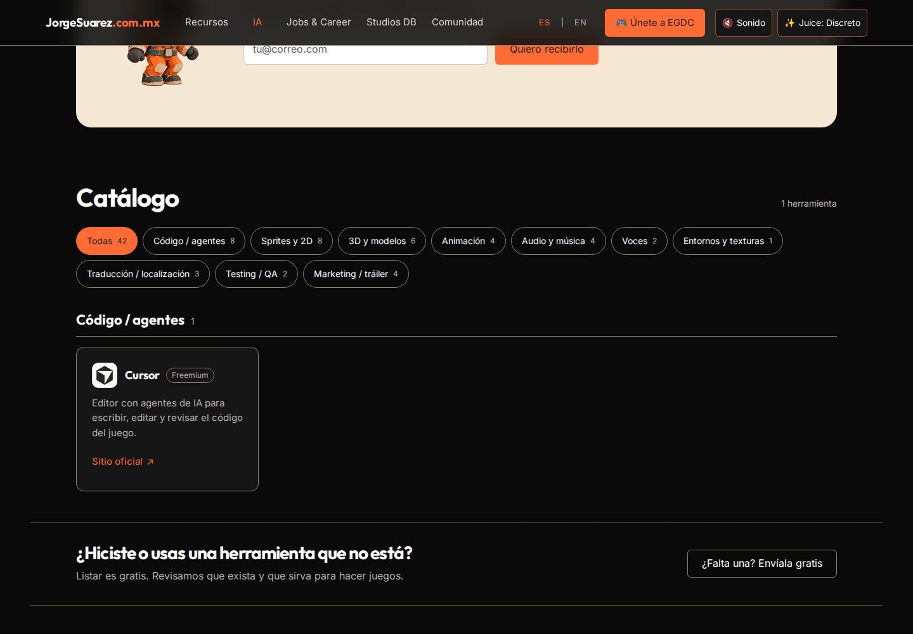
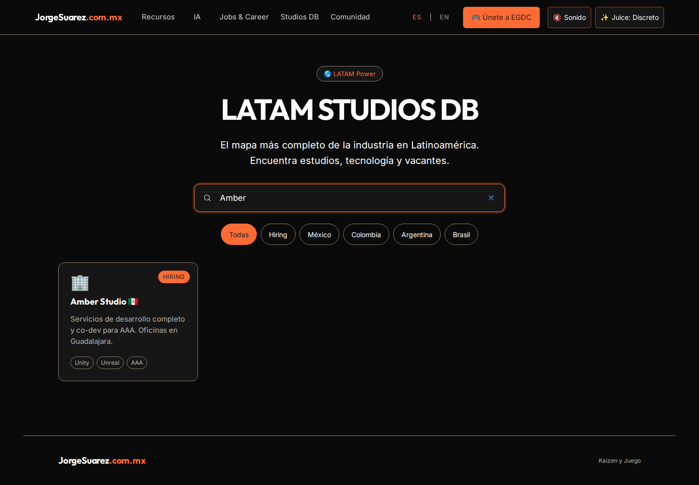

[Español](README.md) | [English](README.en.md)

# Game Industry Resources

## ¿Qué es y por qué existe?
Un sitio de recursos para quienes crean videojuegos, con enfoque en Latinoamérica. Reúne directorios y guías para explorar opciones desde un solo lugar; no es una plataforma de contratación ni valida proveedores.

## ¿Para quién?
Estudiantes, desarrolladores independientes y equipos buscando herramientas, estudios o orientación profesional. Usa un navegador moderno; consultar el directorio no requiere cuenta ni conocimientos de programación. Alojar una copia sí requiere ayuda técnica.

## ¿Cómo empiezo?
1. Abre el [directorio IA](https://gamedev.jorgesuarez.com.mx/ia/). Las capturas proceden de `main` servido localmente, no certifican el despliegue público.
2. Escribe **Cursor** en Buscar herramientas: en la copia verificada el catálogo pasó de 42 herramientas a una coincidencia. Usa categorías para explorar otras áreas y revisa términos y precios en el sitio oficial de cada herramienta.
3. En [Studios DB](https://gamedev.jorgesuarez.com.mx/database.html), busca **Amber**: la búsqueda local deja la ficha coincidente. Las etiquetas Hiring no demuestran vacantes actuales.
4. En [Jobs & Career](https://gamedev.jorgesuarez.com.mx/jobs.html), consulta enlaces y la guía de CV. Confirma cada oferta directamente con el estudio. No envíes correo, solicitudes de patrocinio ni pagos para seguir este recorrido.

En teléfono: [captura vertical legible](docs/media/mobile-search-es.png). Abre las capturas a tamaño completo para leer cada control.

## ¿Cuándo usarlo y cuándo no?
Para descubrir recursos y enlaces. No para comprobar vacantes en tiempo real, recibir asesoría legal o asumir que una herramienta cumple licencias, privacidad o necesidades de tu juego.

## ¿Dónde y en qué estado?
[Inicio](https://gamedev.jorgesuarez.com.mx) · [Código](https://github.com/jorgefsb/game-industry-resources). `main` local verificado el 22 de octubre de 2026: inicio, Jobs, Studios DB, Tools y directorio IA cargan. Búsquedas de IA y estudios verificadas en ES/EN. No se verificaron otras ramas ni PR pendientes.

## Costos y licencia
Consultar la copia no mostró cobro. El directorio anuncia acceso gratuito y un destacado de USD 49 al mes; no probamos pago, activación, cancelación ni envío. Las herramientas externas tienen sus propios precios. No hay LICENSE en este snapshot: no asumir MIT ni permiso general de redistribución. La marca y logotipos de terceros tienen restricciones separadas.

## Privacidad
La preferencia de idioma se guarda en `localStorage`. Boletín, envío de herramientas y destacado tienen formularios que intentan enviar datos a `/ia/api/`; un servidor estático local no los implementa. El Worker existe en código, pero su despliegue, almacenamiento y políticas de retención no fueron verificados. No enviamos formularios ni pagos. Al abrir enlaces externos aplican sus propias políticas.

## Límites y ayuda
- Jobs muestra una lista/ticker basado en datos del repositorio, no un feed de ofertas en vivo comprobado.
- Studios DB usa datos locales: confirma país, tecnología y contratación con cada estudio.
- Tools presenta Standard GDD, Project Budget y Release Checklist, pero sus tres botones enlazan a `#`: **no hay descarga funcional verificada**.
- Portafolio e Interview Prep aparecen como próximamente. Una página o botón no prueba un servicio operativo.
- Para errores o enlaces desactualizados, [abre un issue](https://github.com/jorgefsb/game-industry-resources/issues) sin datos sensibles. No hay plazo de soporte garantizado.

## Video y siguientes pasos

[MP4 · ES](docs/media/walkthrough-es.mp4) · [VTT](docs/media/walkthrough-es.vtt) · [Texto / Transcript](docs/media/transcript-es.md)

[Guía técnica](docs/TECHNICAL.md) · [Canon de documentación](docs/REPOSITORY-DOCUMENTATION.md) · [Aviso de medios](docs/ASSET-NOTICE.md)

Construido por [Jorge Suárez](https://jorgesuarez.com.mx) · [Brandkit oficial / Official brandkit](https://brandkit.jorgesuarez.com.mx/)
